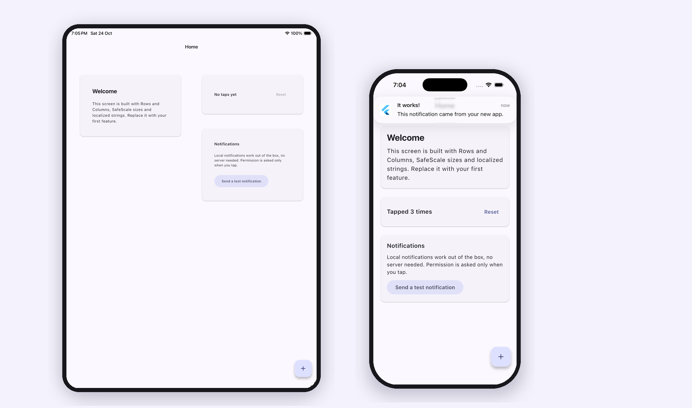

# Flutter Boilerplate

<!-- template:start -->
[](https://github.com/ibtihaajk7/flutter-boilerplate/actions/workflows/ci.yml)
[](https://pub.dev/packages/safe_scale)
[](LICENSE)

**A production-grade starting point for Flutter apps.** The same setup, rules
and quality gates behind [Chess Coach Pro](https://chesscoachpro.com/),
live on the [App Store](https://apps.apple.com/app/id6762184175) and
[Google Play](https://play.google.com/store/apps/details?id=com.dynastytechs.chesscoach).

[](https://github.com/ibtihaajk7/flutter-boilerplate/generate)

⭐ **If it saves you a day of setup, star the repo.** It helps other people find it.



## Why not just `flutter create`?

| | `flutter create` | flutter-boilerplate |
|---|:---:|:---:|
| Analysis | `flutter_lints` defaults | Strict casts, inference and raw types, ~95 rules, infos fail CI |
| Tests | One counter test | 70+ unit and widget tests, coverage gate, every `lib/` file tested |
| Responsive sizing | None | [SafeScale](#safescale) with tuned clamps for small phones, budget phones and tablets |
| Layouts | Phone only | Phone/tablet layouts, text scale clamped, overflow tests at 320 px and 2× text |
| Localization | None | ARB setup plus a checker for missing keys, lost placeholders and duplicate copy |
| Analytics | None | Vendor-neutral service, typed events, automatic screen views | <!-- slim:analytics -->
| Crash reporting | None | Error handlers wired to a swappable reporter | <!-- slim:crash -->
| Notifications | None | Working local notifications, permission asked in context | <!-- slim:notifications -->
| Firebase, Mixpanel, FCM | None | [Tested recipes](docs/recipes/README.md), one file each |
| CI/CD | None | PR checks + Android build; tag to get an AAB and iOS build |
| Team and AI rules | None | [AGENTS.md](AGENTS.md): layout, testing, analytics and l10n rules |
| Renaming | By hand, ~10 files | `make rename NAME=my_app ORG=com.acme` |
| Slimming down | By hand | `make slim WITHOUT=analytics,crash,notifications` |

Nothing is tied to a vendor account: a fresh copy builds and passes CI as is.
Don't need analytics, crash reporting or notifications? [Slim it down](#slim-down)
with one command, or start from the ready-made `slim` branch.

## Start a new app

With the GitHub CLI:

```bash
gh repo create my_app --template ibtihaajk7/flutter-boilerplate --private --clone
```
```bash
cd my_app && make rename NAME=my_app ORG=com.acme DISPLAY="My App"
```
```bash
make check
```

Or click **Use this template** on GitHub, clone your new repo, and run the
same `make rename` line. No `make`? Run
`dart run tool/rename.dart --name my_app --org com.acme --display "My App"`,
then `flutter pub get`.

The rename updates the Dart package and every import, the Android application
ID, namespace and Kotlin package, the iOS bundle ID, and the display name on
both platforms. It also removes this section of the README and then deletes
itself.

## SafeScale

Responsive sizing here is powered by
[**safe_scale**](https://pub.dev/packages/safe_scale), a small package that
scales your design-file sizes to the device *without* the usual "UI bloat" on
problem devices: large-but-low-density phones (iPhone 7 Plus, HD+ Android)
where plain width-based scaling makes everything look oversized.

```dart
Text('Hello', style: TextStyle(fontSize: 18.sp)); // font size from Figma
SizedBox(width: 120.w, height: 48.h);             // sizes from Figma
```

This template wires it in for you: `initSafeScale` runs in `App.build`
against a 390×844 design frame, with tuned clamps for small phones,
low-density large phones and tablets (`lib/core/scale/app_scale.dart`, fully
unit tested). Use it in your own apps:

```bash
flutter pub add safe_scale
```
<!-- template:end -->

## Getting started

Requires Flutter 3.44.1 or newer.

```bash
make setup
```
```bash
make run
```

`make setup` creates `.env` from `.env.example` and gets packages. No `make`?
Run `cp .env.example .env`, `flutter pub get` and `flutter run`.

## Commands

`make` is optional: each target wraps a regular Flutter or Dart command.

| `make` | Plain command | What it does |
|---|---|---|
| `make check` | [5 steps](docs/commands.md#before-you-push) | Everything CI runs |
| `make test` | `flutter test` | Run all tests |
| `make analyze` | `flutter analyze --fatal-infos --fatal-warnings` | Strict analysis |
| `make format` | `dart format lib test tool` | Format code |
| `make l10n` | `flutter gen-l10n` | Regenerate localizations |
| `make hooks` | | Run `make check` before every `git push` |

All commands and what each check enforces: [docs/commands.md](docs/commands.md).

## Project structure

```
lib/
  main.dart          bootstrap only
  app.dart           MaterialApp, SafeScale, theme, l10n, text scale clamp
  core/              analytics, crash, env, l10n, layout, notifications,
                     scale, theme, shared widgets
  features/<name>/   one folder per feature
  l10n/              ARB files (+ generated code)
test/                mirrors lib/
tool/                scripts used by make and CI
docs/                commands, recipes/, plans/ and decisions/
```

## Optional modules

Vendor-neutral services in `lib/core/` that print to the console until you
plug a vendor in. [Recipes](docs/recipes/README.md) add Firebase, Mixpanel
and FCM, each one file plus its tests.

<!-- slim:analytics:start -->
- **Analytics**: `AnalyticsService` fans out to every provider, survives a
  failing one, validates event names, and logs screen views for named routes.

  ```dart
  context.read<AnalyticsService>().track(AnalyticsEvents.buttonTap, {
    AnalyticsParams.buttonName: 'subscribe',
  });
  ```
<!-- slim:analytics:end -->
- **Crash reporting**: uncaught Flutter and async errors already reach `CrashReporter`. <!-- slim:crash -->
- **Local notifications**: shown now or daily at a set time, with permission asked only when the user opts in. <!-- slim:notifications -->

### Slim down

Remove any module you don't need, with its code, tests, packages, strings,
native setup and docs. The project stays green:

```bash
make slim WITHOUT=analytics,crash,notifications
```

Pick any combination. No `make`? Run
`dart run tool/slim.dart --without analytics,crash,notifications`.

<!-- template:start -->
To start lean from the beginning, clone the `slim` branch, which CI rebuilds
from `main` with all three removed:

```bash
git clone --branch slim --depth 1 https://github.com/ibtihaajk7/flutter-boilerplate.git my_app
```
<!-- template:end -->

## Rules

[AGENTS.md](AGENTS.md) holds the rules for this codebase: layout, testing,
analysis, localization and structure. Point your AI coding tool at it, and
read it yourself before your first PR.

## Releasing

Push a tag like `v1.0.0`. The Release workflow builds an Android App Bundle
and an unsigned iOS build. Signing setup is in [docs/release.md](docs/release.md).

---

Responsive sizing by [safe_scale](https://pub.dev/packages/safe_scale).
Started from [flutter-boilerplate](https://github.com/ibtihaajk7/flutter-boilerplate).
